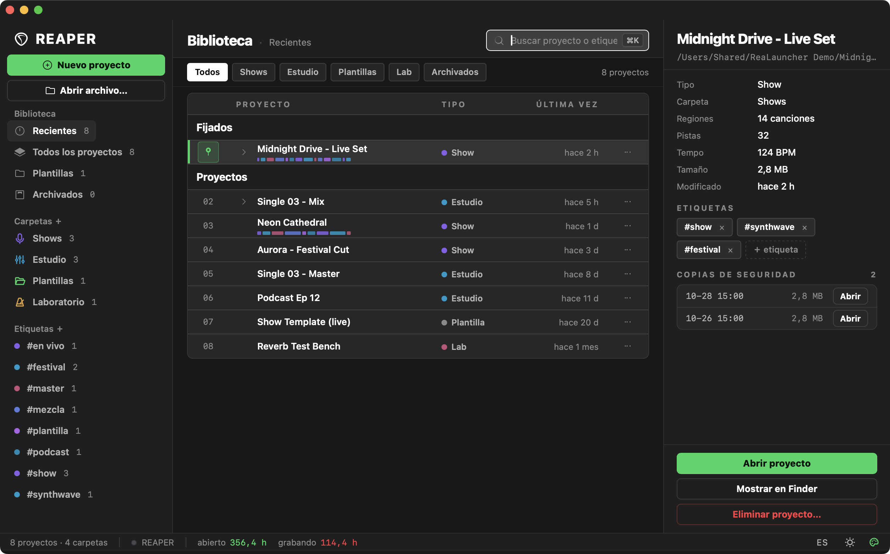
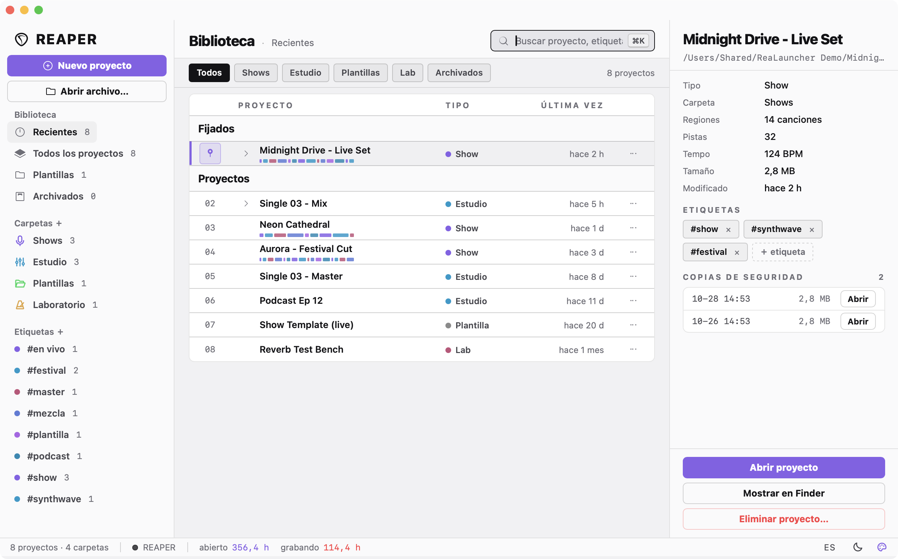
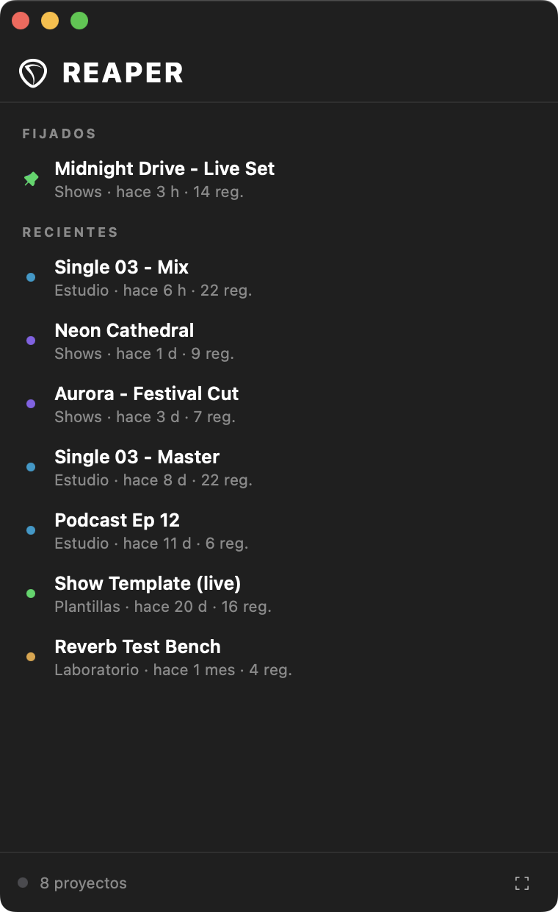
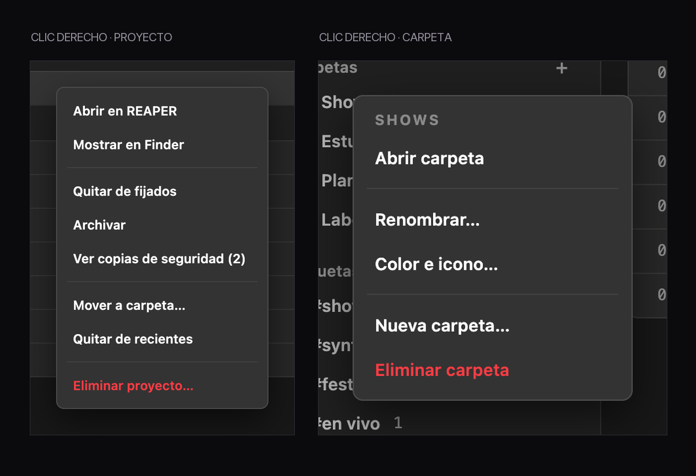
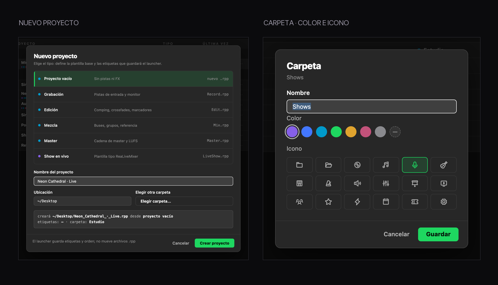

<p align="center">
  
</p>

<p align="center">
  <a href="README.md">English</a> · <b>Español</b> · <a href="https://djenttleman.github.io/project-launcher-for-reaper/#es">Sitio</a>
</p>

<p align="center">
  
  
  
  
  
</p>

<p align="center">
  <i>Hecho por humanos e IA (pero con UI bien hecha), para humanos con sentimientos.</i>
</p>

---

## Por qué existe esto

Voy a ser honesto: siempre me pareció que el launcher de proyectos de REAPER era… pobre.

Sé que REAPER no se destaca por el diseño y no tengo problema con eso — la bestia se gana su aspecto. Pero el launcher era definitivamente el punto débil, sobre todo viniendo de otros DAW como Studio One, donde al menos la cosa se siente un poco más pulida: una lista decente, algo que te diga *dónde* dejaste las cosas.

Así que decidí hacer el mío, con ayuda de IA. Usé **DeepSeek V4.1 Flash** de principio a fin: diseño, código, y también las partes raras.

Empezó como una herramienta para mis propios shows en vivo. Después le crecieron carpetas, etiquetas, copias de seguridad, un inspector y bastantes opiniones sobre el espaciado. Ahora está acá, por si tu ventana de `Choose Project` también te da un poco de tristeza.

## Lo que trae

| | |
|---|---|
| 🌗 **Oscuro, claro y cinco esquemas** | Reapertips, ReaSet Pro, Cian, Ámbar y Rosa, todos con modo claro de verdad. No es un agregado de último minuto. |
| 🗂 **Carpetas y etiquetas virtuales** | Agrupá los proyectos como pensás en ellos: por show, por cliente, por estado de ánimo. Nunca mueve un archivo. |
| 🔎 **Búsqueda y filtros al instante** | Escribí y filtrá por tipo, carpeta, fijados o archivados. `⌘K` y ya estás escribiendo. |
| 🧭 **Inspector de proyecto** | Regiones, pistas, tempo, tamaño y la última vez que lo tocaste, leídos directo del `.rpp`. |
| 🗃 **Copias anidadas** | Cada `.rpp-bak` que está junto al proyecto aparece en una fila desplegable. Se abre o se muestra en Finder. |
| 🩺 **Modo recuperación** | Abre cualquier proyecto con todos los FX offline, o deja que el launcher los traiga online de a uno cuando termine de cargar. `⌥`-clic en Abrir o desde el menú contextual. |
| 🧩 **Crear desde plantillas** | Vacío, grabación, edición, mezcla, master o show en vivo: escribe el archivo correcto en el lugar correcto. |
| 📊 **Estadísticas de sesión** | Horas con REAPER abierto y horas realmente grabando, acumuladas por un script Lua silencioso. |
| 🪟 **Modo slim** | La ventana entera se convierte en una lista angosta: fijados primero, después recientes. Un clic y el proyecto abre — sin inspector, sin opciones. El clic derecho sigue dando el modo recuperación. |
| 🖱 **Menús de clic derecho propios** | Renombrar, cambiar color e icono de carpetas; fijar, archivar, mover o eliminar proyectos. Sin menú nativo de WebKit ni selección de texto. |
| 🔒 **A prueba de actualizaciones** | Los scripts Lua viven en tu carpeta de recursos de REAPER y se registran solos en la lista de acciones: actualizar REAPER no los rompe. |
| ⚡ **Rápido y silencioso** | Ventana nativa, sin Electron, abre en ~0,4 s sin flash blanco ni repintados visibles. |
| ⌘Q **Cierra todo** | Una tecla y se van el launcher y REAPER. |

## Pantallazos

<p align="center">
  
</p>

<p align="center">
  
</p>

<p align="center">
  
</p>

<p align="center">
  
</p>

<p align="center">
  
</p>

<sub>Los datos de las capturas son inventados; el diseño, el espaciado y los detalles son los que te vas a encontrar.</sub>

## Instalación

**Un comando** — clona, compila e instala:

```bash
curl -fsSL https://raw.githubusercontent.com/djenttleman/project-launcher-for-reaper/main/bootstrap.sh | bash
```

**O paso a paso**, si te gusta ver qué corre en tu máquina:

```bash
git clone https://github.com/djenttleman/project-launcher-for-reaper.git ~/dev/project-launcher
cd ~/dev/project-launcher
./install.sh
```

Requisitos: **macOS 13+**, **Xcode Command Line Tools** (`swiftc`) y **REAPER 7**.

El instalador compila la app en `~/Applications/Project Launcher.app`, copia los dos scripts Lua a tu carpeta de recursos de REAPER, los engancha en `__startup.lua` y pone `loadlastproj=19` para que REAPER deje de mostrar su propio diálogo. Respalda los dos archivos que toca y no cambia nada más de tu configuración.

## Cómo funciona

Son dos piezas y un truco. La app es una ventana nativa chica de macOS: AppKit más un WebView, sin Electron, sin Node, nada que descargar en tiempo de ejecución. Del lado de REAPER hay dos scripts Lua: uno abre el launcher al arrancar y el otro acumula en silencio tus horas de sesión. Viven en tu carpeta de recursos y se registran como acción, así que una actualización de REAPER no los toca. La app lee la cabecera de cada `.rpp` para sacar regiones, pistas y tempo, guarda en caché lo que encuentra con fecha de modificación y tamaño como clave, y dibuja todo en su propia interfaz. `loadlastproj=19` le dice a REAPER que arranque con un proyecto nuevo en vez de preguntarte cuál: eso es lo que hace que la ventana propia sea lo primero que ves.

## Para tener en cuenta

- **Solo macOS.** Está hecho con AppKit; portarlo es otro proyecto.
- **No mueve ni renombra nada** por atrás. Las carpetas, etiquetas y fijados viven en `~/Library/Application Support/Project Launcher/library.json`.
- **Eliminar un proyecto** desde el inspector manda el `.rpp` a la Papelera y lo saca de la biblioteca. Pregunta antes.
- **El primer escaneo pide permiso de archivos** en carpetas como Documentos o Descargas: la app solo lee cabeceras de `.rpp`.
- **Desinstalar**: `./install.sh --revert` devuelve el launcher original de REAPER, después borrá `~/Applications/Project Launcher.app` y `~/Library/Application Support/Project Launcher`.

## Sobre hombros ajenos

Nada de esto se vería así sin lo siguiente:

- **[Phosphor Icons](https://phosphoricons.com/)** (MIT) — los iconos de carpeta, tema, acento e idioma, y casi todos los glifos chicos. Van empaquetados como paths SVG; no hay dependencia en tiempo de ejecución ni nada que se descargue al abrir.
- **[El tema Reapertips](https://forum.cockos.com/showthread.php?t=281644)** de [Alez156](https://forum.cockos.com/member.php?u=100131) — la paleta sobre la que se apoya toda la interfaz: ese violeta, los acentos cian y rosa, y una serie de grises que no se sienten planos. Gracias por hacer que REAPER se vea bien; este launcher se apoya en eso.
- **[ReaSet Pro](https://reaset.app/)** — el kit de diseño de mi propia herramienta de shows: espaciado, escala tipográfica y lenguaje de componentes. Project Launcher lo toma prestado a propósito para que los dos se sientan de la misma familia.
- **[DeepSeek](https://www.deepseek.com/) V4.1 Flash** — el modelo que escribió buena parte de esto conmigo.

Todo lo demás — la app, los scripts Lua, la interfaz — es código original bajo licencia MIT.

## Créditos

Hecho por **[@djenttleman](https://github.com/djenttleman)** — ingeniero en vivo, Chile — con **DeepSeek V4.1 Flash** escribiendo buena parte del código. El lenguaje visual toma prestado el kit de diseño de ReaSet Pro; la paleta se apoya en el tema Reapertips.

Si te ahorra diez segundos cada vez que abrís un proyecto, cumplió.

<p align="center"><sub>Hecho por humanos e IA (pero con UI bien hecha), para humanos con sentimientos.</sub></p>

---

<sub>Notas técnicas, arquitectura y números medidos de arranque: [DEVELOPMENT.md](DEVELOPMENT.md).</sub>
