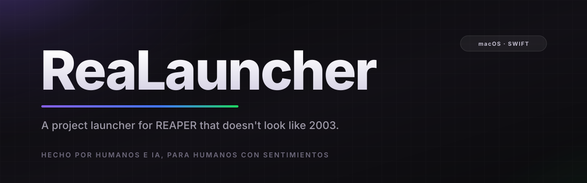
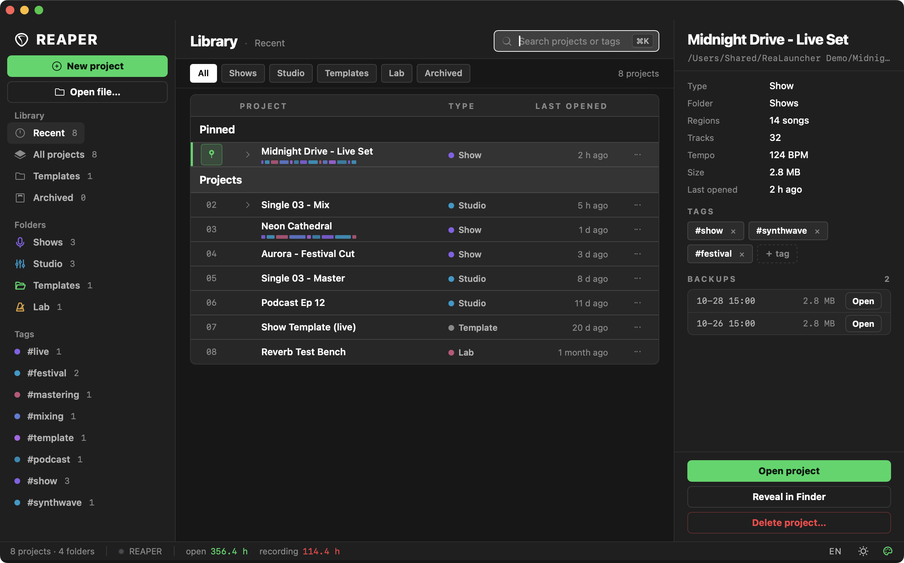
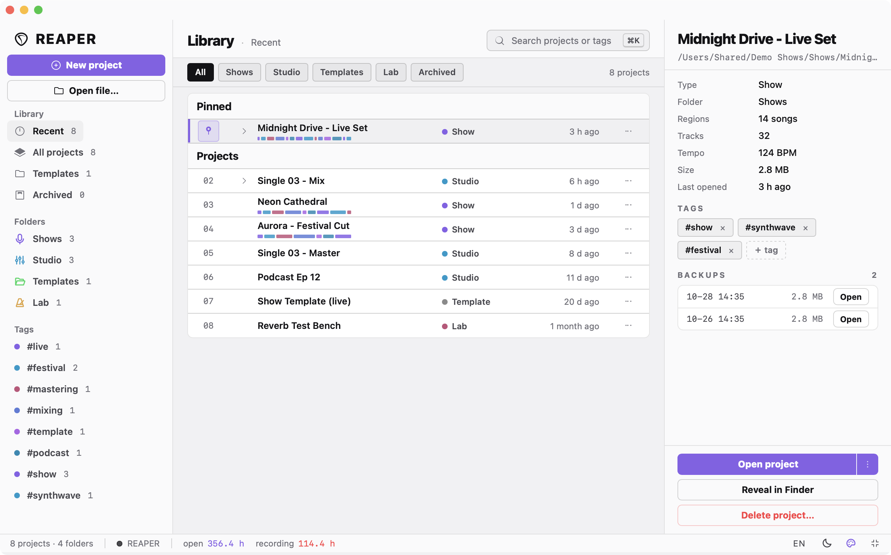
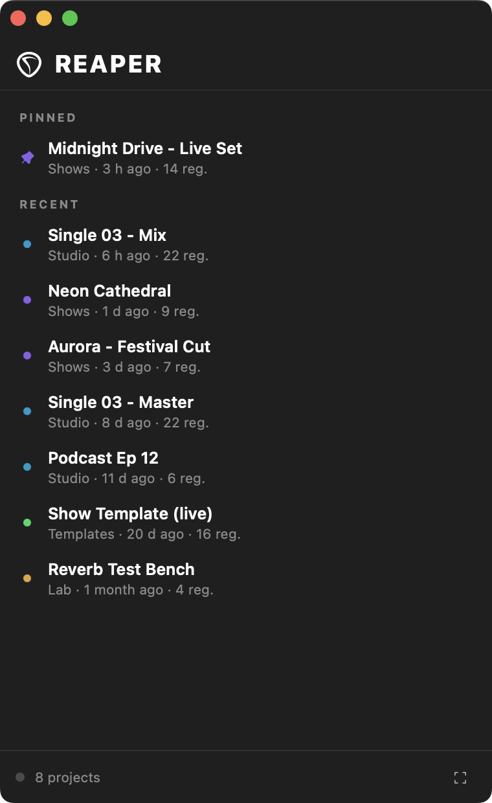
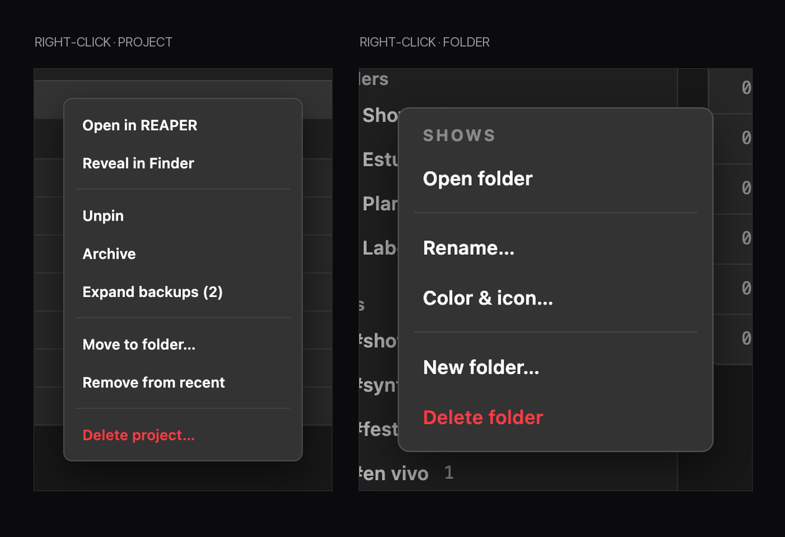
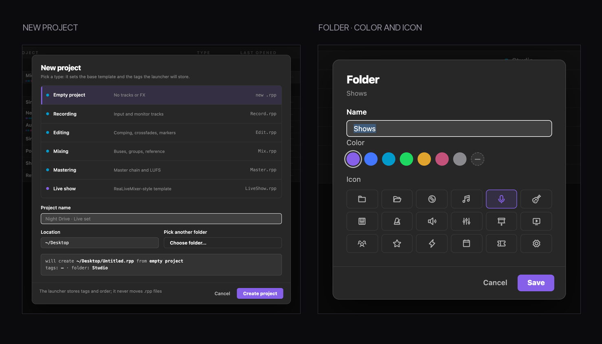

<p align="center">
  
</p>

<p align="center">
  <b>English</b> · <a href="README.es.md">Español</a> · <a href="https://djenttleman.github.io/project-launcher-for-reaper/">Website</a>
</p>

<p align="center">
  
  
  
  
  
</p>

<p align="center">
  <i>Made by humans and AI (but with a properly built UI), for humans with feelings.</i>
</p>

---

## Why this exists

Honestly? I always found REAPER's project launcher… poor.

I know REAPER isn't exactly a design showcase, and I'm fine with that — the thing is a beast and it earns its looks. But the launcher was definitely the weak spot, especially coming from other DAWs like Studio One, where at least the thing feels a little more polished: a proper list, something that tells you *where* you left things.

So I built my own, with AI's help. I used **DeepSeek V4.1 Flash** end to end — design, code, the weird parts too.

It started as a tool for my own live shows. Then it grew folders, tags, backups, an inspector and a lot of opinions about spacing. Now it's here, in case your `Choose Project` window also makes you a little sad.

## Features

| | |
|---|---|
| 🌗 **Dark, light and five color schemes** | Reapertips, ReaSet Pro, Cyan, Amber and Rose, all with a real light mode. Not an afterthought. |
| 🗂 **Virtual folders and tags** | Group your projects however you think about them — by show, by client, by mood. It never moves a single file. |
| 🔎 **Instant search and filters** | Type and filter by type, folder, pinned or archived. `⌘K` and you're typing. |
| 🧭 **Project inspector** | Regions, tracks, tempo, size and the last time you touched it, read straight from the `.rpp`. |
| 🗃 **Nested backups** | Every `.rpp-bak` sitting next to your project shows up in a fold-out row. Open it or reveal it. |
| 🩺 **Recovery mode** | Open any project with all FX offline, or let the launcher bring them online one at a time once it's loaded. `⌥`-click the Open button or use the right-click menu. |
| 🧩 **Create from templates** | Empty, recording, editing, mixing, mastering or a live show — it writes the right file in the right place. |
| 📊 **Session stats** | Hours with REAPER open and hours actually recording, accumulated by a quiet Lua script. |
| 🪟 **Slim mode** | Collapse the whole thing into a narrow list: pinned first, then recent. Click and the project opens — no inspector, no options. Right-click still gives you recovery mode. |
| 🖱 **Its own right-click menus** | Rename, recolor and re-icon folders; pin, archive, move or trash projects. No native WebKit menu, no text selection. |
| 🔒 **Update-proof** | The Lua scripts live in your REAPER resource folder and register themselves in the Action List, so a REAPER update doesn't break them. |
| ⚡ **Fast and quiet** | Native window, no Electron, opens in ~0.4 s with no white flash and no visible redraw. |
| ⌘Q **Quits everything** | One keystroke and both the launcher and REAPER are gone. |

## Screenshots

<p align="center">
  
</p>

<p align="center">
  
</p>

<p align="center">
  
</p>

<p align="center">
  
</p>

<p align="center">
  
</p>

<sub>The demo data in those shots is invented; the layout, the spacing and the little details are what you actually get.</sub>

## Install

**One command** — clones, builds and installs:

```bash
curl -fsSL https://raw.githubusercontent.com/djenttleman/project-launcher-for-reaper/main/bootstrap.sh | bash
```

**Or step by step**, if you like to see what runs on your machine:

```bash
git clone https://github.com/djenttleman/project-launcher-for-reaper.git ~/dev/project-launcher
cd ~/dev/project-launcher
./install.sh
```

Requirements: **macOS 13+**, **Xcode Command Line Tools** (`swiftc`) and **REAPER 7**.

The installer builds the app into `~/Applications/Project Launcher.app`, copies the two Lua scripts into your REAPER resource folder, hooks them into `__startup.lua` and sets `loadlastproj=19` so REAPER stops showing its own dialog. It backs up the two files it edits, and nothing else in your REAPER config is touched.

## How it works

It's two pieces and a trick. The app is a small native macOS window — AppKit plus a WebView, no Electron, no Node, nothing downloaded at runtime. On the REAPER side there are two Lua scripts: one opens the launcher at startup, the other quietly accumulates your session hours. They live in your resource path and register themselves as an action, so a REAPER update doesn't touch them. The app reads the header of each `.rpp` to pull out regions, tracks and tempo, caches what it finds keyed by modification date and size, and renders everything in its own interface. `loadlastproj=19` tells REAPER to start with a new project instead of asking which one — that's what makes the custom window the first thing you see.

## Good to know

- **macOS only.** It's built with AppKit; porting it is a different project.
- **Nothing is moved or renamed** behind your back. Folders, tags and pins live in `~/Library/Application Support/Project Launcher/library.json`.
- **Deleting a project** from the inspector sends the `.rpp` to the Trash and removes it from the library. It asks first.
- **The first scan asks for file access** on folders like Documents or Downloads — the app only reads `.rpp` headers.
- **Uninstall**: `./install.sh --revert` restores REAPER's own launcher, then delete `~/Applications/Project Launcher.app` and `~/Library/Application Support/Project Launcher`.

## Built on other people's work

None of this would look the way it does without these:

- **[Phosphor Icons](https://phosphoricons.com/)** (MIT) — the folder, theme, accent and language glyphs, and most of the small icons. Bundled locally as SVG paths; no runtime dependency, nothing downloaded at startup.
- **[The Reapertips theme](https://forum.cockos.com/showthread.php?t=281644)** by [Alez156](https://forum.cockos.com/member.php?u=100131) — the palette the whole interface leans on: that violet, the cyan and rose accents, and a set of grays that don't look flat. Thanks for making REAPER pleasant to look at; this launcher stands on it.
- **[ReaSet Pro](https://reaset.app/)** — the design kit from my own live-show tool: spacing, type scale and component language. Project Launcher borrows it on purpose so the two feel like the same family.
- **[DeepSeek](https://www.deepseek.com/) V4.1 Flash** — the model that wrote a good chunk of this with me.

Everything else — the app, the Lua scripts, the interface — is original code under the MIT license.

## Credits

Built by **[@djenttleman](https://github.com/djenttleman)** — live engineer, Chile — with **DeepSeek V4.1 Flash** doing a lot of the typing. The visual language borrows the ReaSet Pro design kit; the palette leans on the Reapertips theme.

If it saves you ten seconds every time you open a project, it did its job.

<p align="center"><sub>Made by humans and AI (but with a properly built UI), for humans with feelings.</sub></p>

---

<sub>Technical notes, architecture and measured startup numbers: [DEVELOPMENT.md](DEVELOPMENT.md).</sub>
